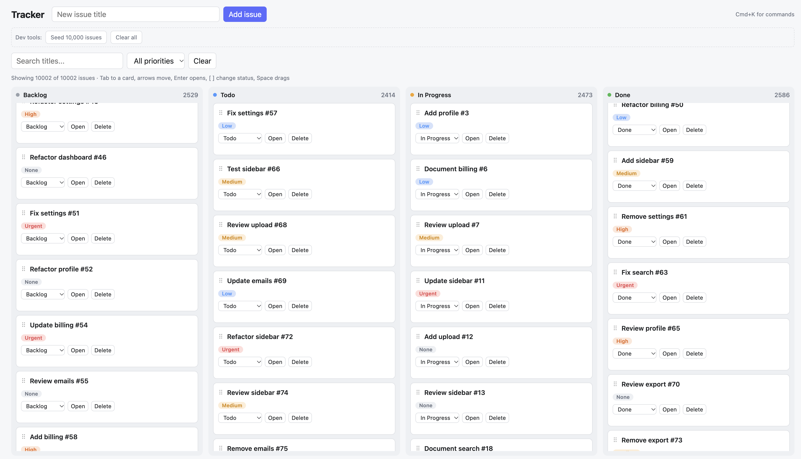
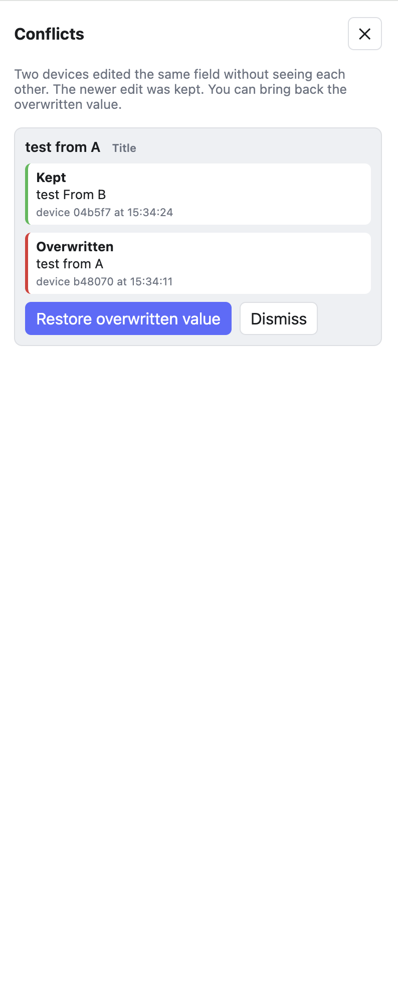
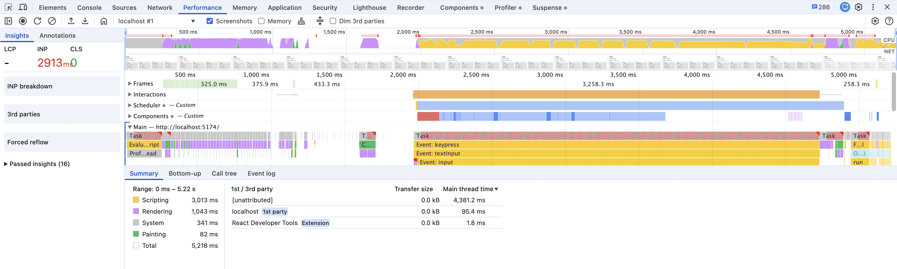
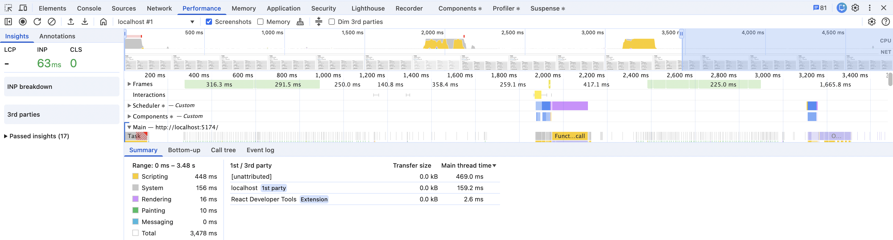

# Tracker

A local-first issue tracker (Linear-style) built with React, TypeScript and Vite. Every action is instant because the UI reads and writes a local database. The network only syncs in the background, so the app keeps working offline.

**Live demo:** https://live-tracker-beta-six.vercel.app/

> The sync server runs on a free Render plan. It sleeps when idle, so the first **Sync now** can take up to a minute. Its database is temporary and resets when the server restarts.



## Features

- Board with columns by status, drag and drop (mouse and keyboard)
- Detail panel to edit title, description, status and priority
- Search and priority filters
- Command palette (`Cmd+K` / `Ctrl+K`)
- Full keyboard navigation on the board
- Works offline, syncs across devices
- Conflict detection with a conflict screen (see what was kept, restore what was overwritten)
- Light and dark theme that follows your system setting (no toggle button)



## Performance

Measured with 10,000 issues, typing one letter in the search box (Chrome DevTools Performance tab).

| Measure                  | Before virtualization | After     |
| ------------------------ | --------------------- | --------- |
| INP (response to typing) | 2913 ms               | **63 ms** |
| Rendering time           | 1,043 ms              | **16 ms** |
| Scripting time           | 3,013 ms              | 448 ms    |

| Before (INP 2913 ms)                        | After (INP 63 ms)                         |
| ------------------------------------------- | ----------------------------------------- |
|  |  |

The fix: each board column is virtualized with TanStack Virtual, so only about 15 cards per column exist in the DOM instead of thousands. Search filtering uses `useTransition` so typing stays responsive.

## How sync works

```
UI (React) --> Repository --> IndexedDB (Dexie)
                                  |
                           Outbox (pending changes)
                                  |
                  Sync engine <--> Server (Hono + SQLite)
```

- **Local database is the source of truth for the UI.** Screens use live queries and never wait for the network.
- **One write path.** Every edit goes through one repository function, which saves locally and adds a mutation to an outbox in a single transaction.
- **Idempotent mutations.** Each has a client-generated id, and the server stores it under a unique constraint, so retries are safe.
- **Hybrid logical clock (HLC)** orders changes fairly even when device clocks disagree.
- **Per-field last-write-wins merge.** Edits to different fields from different devices both survive. The merge is a pure function shared by client and server, and it is commutative and idempotent.
- **Conflict detection.** Each edit records the version it started from. A conflict means an edit was made without seeing the other one. Overwritten values are logged and can be restored.
- **Pull uses a server arrival sequence as the cursor**, not a timestamp, so late-arriving changes are never missed.
- **Soft deletes (tombstones)** so offline devices still learn about deletions.

Full reasoning and rejected alternatives: [ADR 0001: Local-first sync design](docs/adr/0001-sync-design.md).

## Tech stack

- React, TypeScript (strict), Vite
- Dexie (IndexedDB), Zod
- dnd-kit, TanStack Virtual
- Hono + Node built-in SQLite (server)
- pnpm workspaces monorepo
- Vitest, fake-indexeddb, GitHub Actions CI
- Deployed on Vercel (web) and Render (server)

## Project structure

```
apps/
  web/        React app
  server/     Sync server (push and pull endpoints)
packages/
  schema/     Shared Zod schemas, HLC and merge logic
docs/adr/     Architecture decision records
```

## Run locally

Requires Node 22.5 or newer and pnpm.

```bash
pnpm install

# terminal 1: sync server on http://localhost:3001
pnpm --filter server dev

# terminal 2: web app on http://localhost:5173
pnpm --filter web dev
```

In development, the header shows buttons to seed 10,000 issues and clear all data.

To try sync between two devices, open the app in a normal window and an Incognito window, add an issue in one, and click **Sync now** in both.

## Tests

```bash
pnpm --filter @tracker/schema test   # clock and merge logic
pnpm --filter server test            # push and pull endpoints
pnpm --filter web test               # repository, sync engine, conflicts
```

Tests cover convergence (two devices editing offline end up identical, in any arrival order), idempotent retries, offline behavior, paging, and delete semantics.

## Known limitations

- No authentication. Anyone can push to the server.
- The server log grows forever (no compaction or snapshots).
- Sync is manual (button). Automatic sync, multi-tab sync and realtime updates are not built yet.
- Two edits to the same text field keep one winner. Merging text properly would need a CRDT such as Yjs.
- A browser keeps its sync cursor, so if the server database is reset, clear local data to resync.
